<div align="center">


# skill-exposure-manifest

스킬 이름과 별칭을, 런타임이 실제로 해석한 `SKILL.md` 바이트에 묶는 파이썬 라이브러리.

[English](README.md)

Python 3.9+

[](https://pypi.org/project/skill-exposure-manifest/)
[](https://github.com/elfenomenokim/skill-exposure-manifest/actions/workflows/tests.yml)
[](LICENSE)

[설치](#설치) · [빠른 시작](#빠른-시작) · [왜 필요한가](#왜-필요한가) · [레퍼런스](#레퍼런스)

</div>

<p align="center">
  <picture>
    <source media="(prefers-color-scheme: dark)" srcset="https://raw.githubusercontent.com/elfenomenokim/skill-exposure-manifest/main/docs/diagrams/exposure.ko.dark.svg">
    
  </picture>
</p>

**스킬 이름이 정확히 어느 `SKILL.md`를 가리키는지 고정해 두는 라이브러리입니다.** Claude Code나 Codex 같은 에이전트는 `atlas-flow` 같은 스킬 이름을 보고 그 폴더의 `SKILL.md`를 읽습니다. 폴더 이름이 바뀌거나 파일이 링크로 바꿔치기되면, 에이전트는 엉뚱한 파일을 읽거나 없는 스킬을 부릅니다. 그래도 겉으로는 성공한 것처럼 보입니다.

- **목록 만들기:** 스킬 폴더와 정책 파일에서 "이 이름(과 별칭)은 이 파일, 내용 지문은 이것"이라는 목록을 만듭니다.
- **부를 때 확인:** 이름을 정확히 받아 파일을 다시 읽고, 지문이 다르거나 이름이 겹치거나 링크로 바뀌었으면 이유를 대며 거부합니다.
- **빠짐없이:** 등록도 제외도 안 된 스킬 폴더를 찾아 줍니다(`unlisted_skills`). 새 스킬이 목록에서 빠지는 일을 막습니다.

64개 등록을 담은 매니페스트를 만드는 데 97ms(최소) · 119ms(중앙값)입니다. 저장된 측정은 `docs/bench/derive.json`에 있습니다. JSON 입력, JSON 출력, 표준 라이브러리만 씁니다.

## 설치

```sh
pip install skill-exposure-manifest
```

Python 3.9 이상, 의존성 없음. macOS arm64 · Python 3.12에서 확인했습니다.

## 빠른 시작

```python
from skill_exposure_manifest import canonical_policy_manifest, resolve_canonical_skill

manifest, bound = canonical_policy_manifest("skills", "skills/policy.json")
print(len(manifest["entries"]))          # 64
print(manifest["entries"][0])
# {'canonical_name': 'amaranth', 'aliases': [], 'source': {'path': 'amaranth/SKILL.md', 'sha256': '...'}, 'runtime_policy': {'tier': 1, 'model_visible': True}}

print(resolve_canonical_skill("feno-source", project_root="skills", policy_path="skills/policy.json"))
# {'name': 'atlas-browser', 'query': 'feno-source', 'source_path': '.../atlas-browser/SKILL.md', 'omitted': False}
```

별칭은 정식 항목으로 이어집니다. 대소문자가 다르거나, 일부만 같거나, 철자가 비슷한 이름은 이어지지 않습니다.

```python
resolve_canonical_skill("ATLAS-FLOW", project_root="skills", policy_path="skills/policy.json")
# ExposureManifestError: unknown skill or alias: 'ATLAS-FLOW'
```

## 왜 필요한가

프롬프트가 디렉터리 이름으로 스킬을 나열하면 두 가지가 조용히 어긋납니다. 폴더 이름이 바뀌면 모델이 없는 스킬을 부르고, 심볼릭 링크나 오래된 경로는 관리자가 의도하지 않은 파일로 이어집니다. 둘 다 성공한 것처럼 보입니다.

이 라이브러리는 그 연결을 명시적이고 검사 가능하게 만듭니다. 매니페스트는 만들 때의 바이트를 기록하고, 해석기는 그 바이트가 그 뒤에 바뀌었으면 거부합니다. 매니페스트에서 출발한 런타임은 원본이 옮겨진 스킬을 내보낼 수 없습니다.

의도한 성질은 세 가지입니다.

- **정확한 이름만.** 문자열을 그대로 비교합니다. 대소문자를 접거나, 앞뒤를 지우거나, 일부 문자열을 찾지 않습니다. 모호한 요청은 고르지 않고 실패합니다.
- **쓰기 경로 없음.** 만들기와 해석은 파일을 읽습니다. 쓰기 함수도, import 시점 부작용도 없습니다. 검사가 실패해도 읽은 트리를 망가뜨릴 수 없습니다.
- **배치는 호출자 입력.** 프로젝트가 각 `source_path`를 선언합니다. 계열 접두사(`celebrity_`, `mentor_`)와 생성 페르소나 디렉터리는 상수가 아니라 인자입니다.

**다른 도구와의 차이.** Claude Code와 Codex는 스킬 폴더 목록을 읽어 스킬을 찾을 뿐, 이름과 파일 내용을 묶어 확인하지 않습니다. 스킬 마켓플레이스나 플러그인 설치기 같은 도구는 스킬을 만들고 나눠 주는 쪽입니다. 설치된 뒤 이름이 어느 바이트를 가리키는지는 지켜 주지 않습니다. 2026년 11월 조사에서 이 일을 하는 도구는 찾지 못했습니다. 이 라이브러리는 그 사이, 즉 설치된 스킬 묶음 위에 별칭·노출 정책과 내용 확인을 얹는 층입니다.

## 레퍼런스

### `derive_manifest(root, registrations=None)`

`root` 아래 모든 일반 `SKILL.md`를 읽어 정렬하고 `{"schema": "cch-skill-exposure-manifest/1", "entries": [...]}`를 돌려줍니다. 등록되지 않은 원본은 `{"tier": 1, "model_visible": True}`를 받습니다.

### `resolve_skill(query, manifest, *, source_root)`

매니페스트를 검증하고, 묶인 원본을 모두 다시 읽은 뒤, 정식 이름이나 별칭이 `query`와 같은 항목 하나를 깊은 복사로 돌려줍니다.

### `canonical_policy_manifest(project_root, policy_path, *, families=..., generated_root=...)`

런타임 홈이나 프로젝션 디렉터리 없이, 정식 프로젝트 원본과 정책 파일에서 바로 매니페스트를 만듭니다. `(manifest, {name: Path})`를 돌려줍니다.

### `resolve_canonical_skill(query, *, project_root, policy_path, families=..., generated_root=...)`

이름이나 별칭 하나를 정식 원본 파일로 이어 주고, 정책이 그것을 숨기는지 함께 알려 줍니다.

```python
{"name": ..., "query": ..., "source_path": ..., "source": {"path": ...}, "omitted": bool}
```

### 정책 파일

```json
{
  "schema": "cch-skill-exposure-manifest/1",
  "registrations": [
    {
      "canonical_name": "atlas-browser",
      "aliases": ["feno-source"],
      "source_path": "atlas-browser/SKILL.md",
      "runtime_policy": {"tier": 1, "model_visible": true}
    }
  ]
}
```

`source_path`는 선택입니다. 값이 있고 유효하면 그것이 이깁니다. 그래야 프로젝트가 자기 배치를 선언합니다. 없으면 생성 페르소나는 `<generated_root>/<category>/<slug>/SKILL.md`, 나머지는 `<name>/SKILL.md`로 이어집니다.

### 오류

모든 거부는 `ExposureManifestError`(`ValueError`)입니다. 이름이나 별칭 중복, 루트를 벗어나거나 심볼릭 링크인 경로, `SKILL.md`가 아닌 원본, 오래된 다이제스트, 형식이 틀린 등록, 알 수 없는 이름이 여기 해당합니다.

## 숫자

2026-11-19, macOS arm64(M5 Pro), Python 3.12.8에서 쟀습니다. 값은 `docs/bench/derive.json`에서 옵니다. 호스트를 함께 쓰기 때문에 9회 실행의 최소값과 중앙값을 모두 남겼습니다.

| 항목 | 최소 | 중앙값 |
| --- | --- | --- |
| `canonical_policy_manifest`, 등록 64개 | 97ms | 119ms |
| `resolve_canonical_skill`, 정확한 이름 하나 | 82ms | 119ms |
| 같은 호출, `'ATLAS-FLOW'` | 거부, `unknown skill or alias` | |

두 호출 모두 정식 원본 64개의 바이트를 읽고 해시합니다. 그래서 한 번 해석하는 비용이 매니페스트를 만드는 비용과 같습니다. 시작할 때 여러 이름을 해석한다면 한 번 만들어 두고 그 매니페스트로 `resolve_skill`을 부르십시오.

## 한계

- POSIX 경로 규칙만 씁니다. 역슬래시는 모든 플랫폼에서 거부합니다. 만들 때와 다른 호스트에서 매니페스트의 뜻이 달라지지 않게 하려는 것입니다.
- 스키마 문자열은 `cch-skill-exposure-manifest/1`이고, 이 릴리스는 그 하나를 읽습니다.
- 캐시가 없습니다. 모든 해석이 묶인 바이트를 다시 읽습니다. 반복문에서 느리면 시작 시점에 한 번 만드십시오.
- Linux와 Windows에서는 실행해 보지 않았습니다.

## 자주 묻는 질문

**오래된 다이제스트를 왜 갱신하지 않고 거부합니까?** 원본이 바뀐 것은 세부가 아니라 결정입니다. 조용히 다시 해시하면, 런타임이 내놓는 스킬이 정책이 지목한 스킬과 다르다는 사실이 가려집니다.

**tier-2 스킬을 숨길 수 있습니까?** `"model_visible": false`로 숨길 수 있습니다. tier-1 항목은 숨길 수 없고, 그 조합은 오류입니다.

## 기여

버그 보고와 패치를 환영합니다. 통과해야 하는 검사와 동작 변경에 필요한 픽스처는 [CONTRIBUTING.md](CONTRIBUTING.md)에 있습니다.

## 라이선스

MIT, [LICENSE](LICENSE).
