<div align="center">


# skill-exposure-manifest

A Python library that binds skill names and aliases to the exact `SKILL.md` bytes the runtime resolved.

[한국어](README.ko.md) · Python 3.9+

[](https://pypi.org/project/skill-exposure-manifest/)
[](https://github.com/elfenomenokim/skill-exposure-manifest/actions/workflows/tests.yml)
[](LICENSE)

[Install](#install) · [Quick start](#quick-start) · [Why](#why) · [Reference](#reference)

</div>

<p align="center">
  <picture>
    <source media="(prefers-color-scheme: dark)" srcset="https://raw.githubusercontent.com/elfenomenokim/skill-exposure-manifest/main/docs/diagrams/exposure.dark.svg">
    
  </picture>
</p>

**A library that pins each skill name to the exact `SKILL.md` it means.** Agents such as Claude Code and Codex read a skill's `SKILL.md` by its name, like `atlas-flow`. When a folder is renamed or the file is swapped for a link, the agent reads the wrong file or calls a skill that is gone, and it still looks like success.

- **Build the list:** from the skills folder and a policy file, record "this name (and its aliases) is this file, with this content hash".
- **Check on use:** take the exact name, re-read the file, and refuse with the reason when the hash changed, a name collides, or the path became a link.
- **Keep it complete:** find skill folders that are neither registered nor excluded (`unlisted_skills`), so a new skill cannot silently drop out.

Building a 64-entry manifest takes 97 ms minimum and 119 ms median, saved in `docs/bench/derive.json`. JSON in, JSON out, standard library only.

## Install

```sh
pip install skill-exposure-manifest
```

Python 3.9+. No dependencies. Verified on macOS arm64 with Python 3.12.

## Quick start

```python
from skill_exposure_manifest import canonical_policy_manifest, resolve_canonical_skill

manifest, bound = canonical_policy_manifest("skills", "skills/policy.json")
print(len(manifest["entries"]))          # 64
print(manifest["entries"][0])
# {'canonical_name': 'amaranth', 'aliases': [], 'source': {'path': 'amaranth/SKILL.md', 'sha256': '...'}, 'runtime_policy': {'tier': 1, 'model_visible': True}}

print(resolve_canonical_skill("feno-source", project_root="skills", policy_path="skills/policy.json"))
# {'name': 'atlas-browser', 'query': 'feno-source', 'source_path': '.../atlas-browser/SKILL.md', 'omitted': False}
```

An alias resolves to its canonical entry. A name that differs in case, a substring, or a near spelling does not:

```python
resolve_canonical_skill("ATLAS-FLOW", project_root="skills", policy_path="skills/policy.json")
# ExposureManifestError: unknown skill or alias: 'ATLAS-FLOW'
```

## Why

A prompt that lists skills by directory name has two quiet failure modes. A renamed folder makes the model call a skill that no longer exists. A symlink or a stale path makes it resolve a file the maintainer did not mean. Both look like success.

This library makes the binding explicit and checkable. The manifest records the bytes that were current when it was derived, and the resolver refuses when those bytes have since changed. A runtime that starts from the manifest cannot serve a skill whose source moved.

Three properties are deliberate:

- **Exact names only.** Resolution compares strings, never case-folds, strips, or matches substrings. An ambiguous request fails instead of picking.
- **No write path.** Derivation and resolution read files. There is no writer function and no import-time side effect, so a failed check cannot damage the tree it read.
- **Layout is a caller input.** A project declares each `source_path`; family prefixes (`celebrity_`, `mentor_`) and a generated-persona directory are arguments, not constants.

**How it differs.** Claude Code and Codex discover skills by listing their folders; they do not bind a name to the file's bytes. Skill marketplaces and plugin installers author and distribute skills; once installed, nothing checks which bytes a name resolves to. A November 2026 survey found no tool doing this job. This library is that layer: an alias and exposure policy, with a content check, over an installed skill set.

## Reference

### `derive_manifest(root, registrations=None)`

Reads every regular `SKILL.md` under `root`, sorts them, and returns `{"schema": "cch-skill-exposure-manifest/1", "entries": [...]}`. An unregistered source gets `{"tier": 1, "model_visible": True}`.

### `resolve_skill(query, manifest, *, source_root)`

Validates the manifest, re-reads each bound source, and returns a deep copy of the one entry whose canonical name or alias equals `query`.

### `canonical_policy_manifest(project_root, policy_path, *, families=..., generated_root=...)`

Derives a manifest directly from canonical project sources plus a policy file, without needing a runtime home or projection. Returns `(manifest, {name: Path})`.

### `resolve_canonical_skill(query, *, project_root, policy_path, families=..., generated_root=...)`

Resolves one name or alias to its canonical source file and reports whether the policy hides it:

```python
{"name": ..., "query": ..., "source_path": ..., "source": {"path": ...}, "omitted": bool}
```

### Policy file

```json
{
  "schema": "cch-skill-exposure-manifest/1",
  "registrations": [
    {
      "canonical_name": "atlas-browser",
      "aliases": ["feno-source"],
      "source_path": "atlas-browser/SKILL.md",
      "runtime_policy": {"tier": 1, "model_visible": true}
    }
  ]
}
```

`source_path` is optional. When present and valid it wins, so a project declares its own layout. Without it, a generated persona resolves under `<generated_root>/<category>/<slug>/SKILL.md`, and everything else under `<name>/SKILL.md`.

### Errors

Every failure raises `ExposureManifestError` (a `ValueError`): duplicate name or alias, escaped or symlinked path, non-`SKILL.md` source, stale digest, malformed registration, unknown name.

## Numbers

Measured on 2026-11-19 on macOS arm64 (M5 Pro), Python 3.12.8, from `docs/bench/derive.json` (nine runs, warm page cache; min and median both saved because the host is shared).

| What | Min | Median |
| --- | --- | --- |
| `canonical_policy_manifest`, 64 registrations | 97 ms | 119 ms |
| `resolve_canonical_skill`, one exact name | 82 ms | 119 ms |
| Same, `'ATLAS-FLOW'` | refused, `unknown skill or alias` | |

Both calls read and hash all 64 canonical sources, which is why one resolution costs a full derive. A runtime that resolves many names per start should derive once and call `resolve_skill` against the returned manifest.

## Limits

- POSIX path rules only. Backslashes are refused on every platform so a manifest cannot change meaning between hosts.
- The schema string is `cch-skill-exposure-manifest/1`; this release reads that one.
- No cache. Every resolve re-reads the bound bytes by design. If that is too slow for your loop, derive once per start.
- Linux and Windows have not been exercised.

## FAQ

**Why refuse a stale digest instead of updating it?** A changed source is a decision, not a detail. Silently re-hashing would hide that the skill the runtime offers is not the skill the policy named.

**Can a tier-2 skill be hidden?** Yes, with `"model_visible": false`. A tier-1 entry may not be hidden; that combination is an error.

## Contributing

Bug reports and patches are welcome. See [CONTRIBUTING.md](CONTRIBUTING.md) for the check that must pass and the fixture each behaviour change needs.

## Licence

MIT, in [LICENSE](LICENSE).
